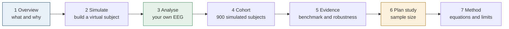
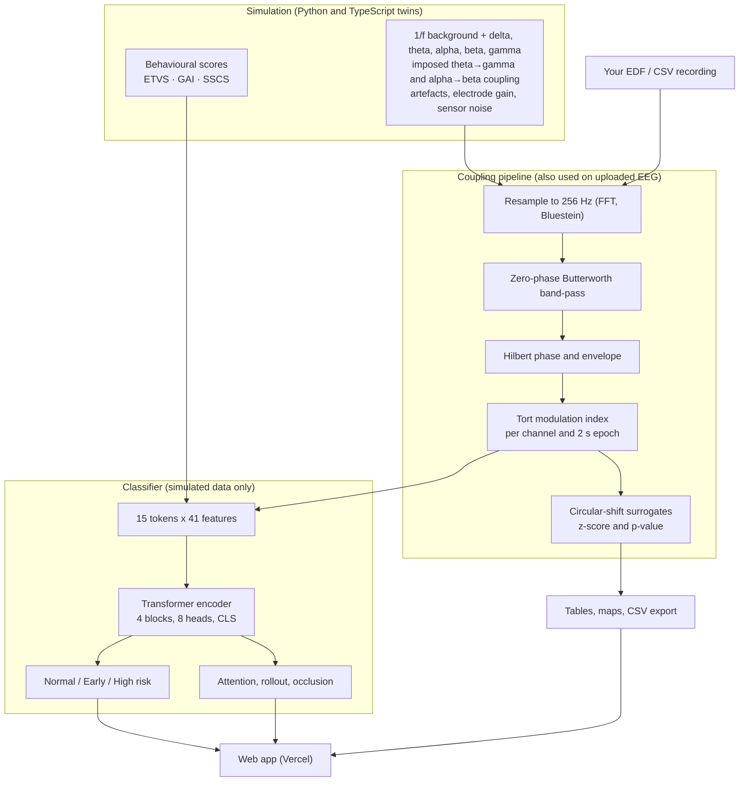

<div align="center">

# NeuroPAC

### An EEG cross-frequency coupling workbench for neuro-oncology research

Analyse recordings locally · benchmark methods on ground-truth simulations · explain a Transformer classifier · plan the validation study

<p><a href="https://pytorch.org"></a> <a href="https://scikit-learn.org"></a> <a href="https://scipy.org"></a> <a href="https://numpy.org"></a> <a href="https://www.python.org"></a> <a href="https://react.dev"></a> <a href="https://www.typescriptlang.org"></a> <a href="https://vitejs.dev"></a> <a href="https://vitest.dev"></a> <a href="https://vercel.com"></a> <a href="https://nodejs.org"></a> <a href="https://github.com/Shrikant-Kudale/Neuro-AI"></a> <a href="https://mermaid.js.org"></a></p>
<p><a href="https://en.wikipedia.org/wiki/Artificial_intelligence"></a> <a href="https://en.wikipedia.org/wiki/Deep_learning"></a> <a href="https://en.wikipedia.org/wiki/Machine_learning"></a> <a href="https://en.wikipedia.org/wiki/Signal_processing"></a> <a href="https://en.wikipedia.org/wiki/Computational_neuroscience"></a> <a href="https://en.wikipedia.org/wiki/Electroencephalography"></a> <a href="https://en.wikipedia.org/wiki/Glioma"></a> <a href="https://en.wikipedia.org/wiki/Behavioral_neuroscience"></a> <a href="https://en.wikipedia.org/wiki/Explainable_artificial_intelligence"></a> <a href="https://en.wikipedia.org/wiki/Health_informatics"></a></p>

<p>
<a href="#-quick-start"><b>Quick start</b></a> ·
<a href="#-what-it-is-for"><b>What it is for</b></a> ·
<a href="#-the-workflow"><b>Workflow</b></a> ·
<a href="#-how-it-works"><b>How it works</b></a> ·
<a href="#-measured-results"><b>Results</b></a> ·
<a href="#-deploy-on-vercel"><b>Deploy</b></a> ·
<a href="#-limitations-and-responsible-use"><b>Limits</b></a>
</p>

</div>

> **Research use only.** NeuroPAC is not a medical device and must not be used to screen, diagnose or reassure anyone. The classifier has only ever seen simulated recordings.

---

## 🧠 Why this exists

Before a brain tumour is large enough to appear on an MRI, it may already disturb how the brain's rhythms are coordinated. Slow **theta** waves (4–8 Hz) act as a reference clock for fast **gamma** bursts (30–80 Hz); this *phase-amplitude coupling* (PAC) underpins memory and attention, and it is weakened in glioma. Eye-movement, gait and speech measures drift as well, although less specifically.

Two things stand in the way of testing that idea: public datasets that pair early-tumour EEG with behavioural measures do not exist, and coupling estimators are easy to get wrong. NeuroPAC addresses both. It provides a validated coupling pipeline for real recordings, a simulator with known ground truth for stress-testing methods, and a planner for the prospective study that real validation needs.

## 🎯 What it is for

| Use | What you do | Data |
|---|---|---|
| **Analyse real EEG** | Load an EDF or CSV file; get theta–gamma and alpha–beta modulation index per channel and epoch, surrogate z-scores and p-values, scalp maps and a CSV export. | Your recording, processed in the browser |
| **Test methods against ground truth** | Create subjects with a chosen amount and location of coupling loss; vary noise, artefacts and lesion geometry; see how estimates and a classifier respond. | Simulated |
| **Plan the validation study** | Convert an expected AUC or sensitivity into the cases and controls a prospective cohort needs (Hanley–McNeil, Buderer). | Your assumptions |
| **Teach cross-frequency coupling** | Interactive figures link the raw trace, the phase-amplitude histogram and the modulation index. | Simulated |

## 🚀 Quick start

```bash
git clone https://github.com/Shrikant-Kudale/Neuro-AI.git
cd Neuro-AI
npm install
npm run dev          # http://localhost:5173
```

Open **Analyse**, press *Normal / Early disruption / High-risk* under "No file?" to load an example, then *Run analysis*.

## 🧭 The workflow

The seven pages follow the order in which a research question is worked through; each ends with a link to the next.



<details>
<summary><b>Page by page</b></summary>

| Step | Page | Purpose |
|---|---|---|
| 1 | Overview | Orientation, uses, limits, an interactive figure of theta-gated gamma |
| 2 | Simulate | Sliders for coupling loss, alpha–beta elevation, gamma excess, scattered or focal lesion (click the scalp), time course, ETVS/GAI/SSCS, noise. Outputs: classifier probabilities, EEG viewer, phase-amplitude histograms, scalp maps, attention, occlusion map, sensitivity sweep |
| 3 | Analyse | Upload EDF/CSV → channel selection → coupling with surrogate statistics → tables, heat maps, scalp map, CSV |
| 4 | Cohort | PCA map of 900 subjects; click one to re-run the model in the browser and compare with PyTorch |
| 5 | Evidence | Six models, repeated splits, ROC, confusion matrix, calibration, ablation, noise, unseen lesion geometry, attention, importance |
| 6 | Plan study | Sample size for AUC, sensitivity and specificity, with attrition |
| 7 | Method | Equations, architecture, simulation specification, software validation, references |

</details>

## ⚙️ How it works



### Coupling measure

For each channel and 2-second epoch, theta phase comes from the Hilbert transform and gamma amplitude from its envelope. With N = 18 phase bins and P(j) the normalised mean amplitude in bin j:

```
MI = D_KL(P || Uniform) / log N = (log N - H(P)) / log N
```

Filters are 4th-order Butterworth band-passes applied forward and backward (zero phase). Epochs above the artefact limit (default ±150 µV) are excluded from channel summaries. On uploaded recordings each channel's MI is tested against circular-shift surrogates.

### Classifier

| Component | Setting |
|---|---|
| Input | 15 tokens × 41: 19 theta–gamma MI, 19 alpha–beta MI, ETVS, GAI, SSCS |
| Encoder | learnable positions + `[CLS]`; 4 pre-LayerNorm blocks, 8 heads, FFN 256 (GELU), dropout 0.1 |
| Head | 128 → 64 → 3 |
| Size | ≈ 546 k parameters |
| Training | Adam 3e-4, cosine schedule, batch 32, early stopping, three seeds |
| Baselines | 1-D CNN, MLP, logistic regression, random forest, gradient boosting |

### Simulation

Subjects are generated with explicit, adjustable coupling, so the truth is known. Class effects follow the direction reported in the literature (theta–gamma loss, alpha–beta rise, gamma excess) and the simulation adds the nuisance structure real cohorts have: overlapping severity, disruption that varies in time, noisy behavioural scores sharing a fatigue/age confounder, electrode-gain variation and ocular artefacts. All parameters are in `research/neuroai/config.py` and shown on the Method page.

## 📊 Measured results

Produced by `research/run_pipeline.py` (mean ± SD over three stratified 70/15/15 splits and initialisations; 135 test subjects each). They describe performance **on simulated data only**.

| Model | Accuracy | Macro F1 | AUC-ROC |
|---|---|---|---|
| **Transformer** | 75.3% ± 0.9 | 0.746 | 0.885 |
| 1-D CNN | 72.3% ± 3.6 | 0.724 | 0.882 |
| MLP | 60.5% ± 5.1 | 0.590 | 0.773 |
| Logistic regression | 60.2% ± 4.4 | 0.602 | 0.788 |
| Random forest | 67.7% ± 2.4 | 0.672 | 0.831 |
| Gradient boosting | 77.8% ± 1.8 | 0.772 | 0.901 |

Transformer on the primary split: accuracy 76.3% (95% bootstrap CI 68.9–83.7%), macro AUC 0.918.

| Feature set | Accuracy | Early-Disruption F1 |
|---|---|---|
| PAC + behavioural (full) | 76.3% | 0.66 |
| PAC only | 45.2% | 0.35 |
| Behavioural only | 78.5% | 0.71 |
| Theta–gamma PAC only | 53.3% | 0.25 |
| Alpha–beta PAC only | 44.4% | 0.46 |

* Unseen focal-lesion geometry: 73.3% accuracy (in-distribution 76.3%).
* Epoch order shuffled at test time: 76.3% – the model uses little temporal order.
* Gradient boosting performs comparably to the Transformer; the Transformer is kept for its epoch-level attention and its handling of time-varying disruption.

## 🗂️ Repository

```
.
├── README.md · LICENSE
├── package.json · vite.config.ts · tsconfig.json · vercel.json · index.html
├── public/
│   ├── model/   transformer_sim.bin + .json      float32 weights, scaler, architecture
│   └── data/    results_sim.json, cohort_sim.*, manifest.json (DSP + simulation spec)
├── src/
│   ├── lib/        fft · dsp · pac · generator · model · recording · resample · planner · studio
│   ├── components/ EEG viewer, scalp maps, charts, hero figure
│   └── pages/      Home · Lab · Analyse · Cohort · Results · Planner · Method
├── research/
│   ├── neuroai/    config · dsp · generator · features · models · train · evaluate · explain · export
│   ├── run_pipeline.py · make_fixtures.py · tests/ · requirements.txt
└── tests/          vitest: Python↔TypeScript parity, readers, resampler, surrogates, planner, page rendering
```

## 🌐 Deploy on Vercel

1. Push the repository to GitHub.
2. In Vercel choose **Add New → Project**, import it, keep the detected **Vite** preset (build `npm run build`, output `dist`), and deploy.

`vercel.json` already contains the single-page-app rewrite and cache headers. Trained models and results are committed under `public/`, so no Python runs at build time.

## 🔬 Reproduce the research

```bash
cd research
python -m venv .venv && source .venv/bin/activate     # Windows: .venv\Scripts\activate
pip install -r requirements.txt
python run_pipeline.py        # generate, extract, train, benchmark, explain, export (~6 min, one CPU core)
python make_fixtures.py       # refresh cross-language parity fixtures
pytest -q                     # Python tests
cd .. && npm test             # browser code matches PyTorch; readers, resampler, surrogates, planner, pages
```

Options: `--seeds 42 43 44`, `--epochs 80`, `--quick` for a smoke run. All randomness is seeded.

## ✅ How the software is checked

| Check | Result |
|---|---|
| Browser modulation index vs Python on the same signal | within 2·10⁻⁴ |
| Browser Transformer logits and attention vs PyTorch | within 2·10⁻³ |
| Bluestein DFT vs direct DFT; 500→256 Hz resampling of a 10 Hz sine | tests pass |
| EDF reader round trip; CSV header, time column and rate inference | tests pass |
| Surrogate test separates coupled from uncoupled synthetic gamma | tests pass |
| Hanley–McNeil standard error vs hand calculation | tests pass |
| Every page renders against the exported data | 7 of 7 |

## ⚠️ Limitations and responsible use

* Training and evaluation data are simulated under stated assumptions; the results show learnability, not clinical accuracy.
* Scalp EEG blurs intracranial coupling effects; PAC also changes in epilepsy, anxiety, sleep loss and with alcohol. Specificity for tumours is untested.
* The Analyse page measures coupling in real EEG but the classifier has **not** been validated on it and is deliberately not applied to uploaded files.
* The interface has automated render tests but no manual cross-browser review.

**Suggested next steps:** check the coupling pipeline on the Temple University Hospital EEG Corpus; design a prospective cohort with the planner; learn coupling features directly from raw waveforms.

## 📚 References

Canolty & Knight 2010 · Tort et al. 2010 · Bao et al. 2020 · Vaswani et al. 2017 · Abnar & Zuidema 2020 · Hanley & McNeil 1982 · Buderer 1996 · Obeid & Picone 2016.

## 👥 Credits

Developed by **Shrikant Kudale** under the guidance of **Prof. Dr. Jayashree Prasad**.

Released under the [MIT License](LICENSE).
