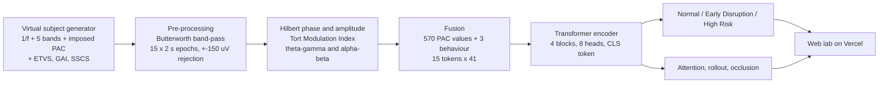

<div align="center">

# NeuroPAC Lab

### Neuro-cognitive AI fingerprinting for pre-radiographic brain-tumour risk

**Simulate EEG · measure phase-amplitude coupling · run a Transformer in your browser · see why it decided**

<p>
<br/>

</p>


<sub>Artificial intelligence · Deep learning · Machine learning · Computer vision of biosignals · Neuroscience · Psychology and behaviour · Medicine · Explainable AI</sub>

</div>

---

> **Research prototype, not a medical device.** Every recording in this project is simulated. Nothing here can screen, diagnose or reassure a person.

## The idea in one minute

An MRI can only see a tumour once it is a mass. Before that, a growing tumour already disturbs how the brain's rhythms coordinate. Slow **theta** waves (4–8 Hz) act as a clock for fast **gamma** bursts (30–80 Hz); this *phase-amplitude coupling* (PAC) supports memory and attention and weakens around glioma. Eye-movement, gait and speech patterns drift as well, though noisily.

This project asks one question: **can a model learn the coupling signature, together with those three behavioural scores, well enough to flag risk before imaging could?** It answers it on simulated cohorts, exposes every step in an interactive lab, and states plainly where the simulation, not the biology, is doing the work.

## What is in the app

| Page | What you do |
|---|---|
| **Home** | A live theta/gamma instrument: drag the coupling slider and watch the Modulation Index fall. Headline measured results. |
| **Patient lab** | Build a virtual patient (coupling loss, alpha-beta elevation, gamma hyperexcitability, scattered or focal lesion placed by clicking a scalp map, time course, ETVS / GAI / SSCS, sensor noise, seed). The app generates 19 channels × 30 s of EEG, computes PAC for every channel and epoch, scores it with the Transformer, and explains the score with attention over epochs and a channel occlusion map. A dose-response sweep shows how the estimate moves as disruption grows. You can also paste your own 573 features. |
| **Cohort** | The 900 simulated subjects in PCA space. Click one: the browser re-runs the network and compares it with the stored PyTorch prediction. |
| **Results** | Six models, three independent splits, bootstrap intervals, calibration, ablations, noise, unseen lesion geometry, epoch-shuffle test, attention and importance maps, real training curves. |
| **Method** | Equations, architecture, generator settings, the choices made where the paper is silent. |
| **Paper** | Citation, references, responsible-use statement. |

Everything runs client-side: the generator, the signal processing and the trained network are TypeScript. No server, no upload.

## Workflow



### Signal processing

For each channel and 2 s epoch the theta phase φ comes from the Hilbert transform and the gamma amplitude *A* from its envelope. With *N* = 18 phase bins and *P*(j) the normalised mean amplitude in bin *j*:

```
MI = D_KL(P || Uniform) / log N = (log N - H(P)) / log N
```

Filters are 4th-order Butterworth band-passes run forward and backward (zero phase). Epochs above ±150 µV are rejected and their MI interpolated from neighbours.

### Model

| Component | Setting |
|---|---|
| Input | 15 tokens × 41 (19 theta-gamma MI, 19 alpha-beta MI, ETVS, GAI, SSCS) |
| Embedding | Linear 41 → 128, learnable positions, prepended `[CLS]` |
| Encoder | 4 pre-LayerNorm blocks, 8 heads (d_k = 16), FFN 256 with GELU, dropout 0.1 |
| Head | 128 → 64 → 3, softmax |
| Parameters | ≈ 545 k |
| Optimisation | Adam 3e-4, weight decay 1e-5, cosine to 1e-6, batch 32, ≤ 80 epochs, early stopping (patience 10) |
| Baselines | MLP (573 → 256 → 128 → 3), 3-layer 1-D CNN, logistic regression, random forest, gradient boosting |

### Two simulation profiles

* **Paper spec** uses the parameters stated in the publication.
* **Hard mode** adds what a real cohort would have: a continuous latent severity that makes classes overlap, disruption that varies across epochs, noisier behavioural scores sharing a fatigue/age confounder, electrode-gain variation and ocular artefacts.

## Measured results

All numbers below are written by `research/run_pipeline.py` (mean ± SD over three independent stratified 70/15/15 splits and initialisations, 135 test subjects each).

### Paper-spec simulation

| Model | Accuracy | Macro F1 | AUC-ROC | Params |
|---|---|---|---|---|
| **Transformer (ours)** | 98.0% ± 0.7 | 0.980 | 0.999 | 546k |
| CNN baseline | 95.3% ± 0.7 | 0.953 | 0.996 | 66k |
| MLP baseline | 78.5% ± 2.2 | 0.780 | 0.927 | 181k |
| Logistic regression | 87.7% ± 3.6 | 0.876 | 0.964 | – |
| Random forest | 93.8% ± 1.5 | 0.938 | 0.990 | – |
| Gradient boosting | 99.0% ± 0.9 | 0.990 | 0.999 | – |

Transformer on the primary split: accuracy 98.5% (95% bootstrap CI 96.3–100.0%), macro AUC 0.999.

| Feature set | Accuracy | Early-Disruption F1 |
|---|---|---|
| PAC + behavioural (full) | 98.5% | 0.98 |
| PAC only | 82.2% | 0.69 |
| Behavioural only | 99.3% | 0.99 |
| Theta–gamma PAC only | 75.6% | 0.61 |
| Alpha–beta PAC only | 42.2% | 0.46 |

Robustness (Transformer): focal lesions unseen in training: 93.3% · epoch order shuffled: 98.5% · in-distribution: 98.5%.

### Hard-mode simulation

| Model | Accuracy | Macro F1 | AUC-ROC | Params |
|---|---|---|---|---|
| **Transformer (ours)** | 75.3% ± 0.9 | 0.746 | 0.885 | 546k |
| CNN baseline | 72.3% ± 3.6 | 0.724 | 0.882 | 66k |
| MLP baseline | 60.5% ± 5.1 | 0.590 | 0.773 | 181k |
| Logistic regression | 60.2% ± 4.4 | 0.602 | 0.788 | – |
| Random forest | 67.7% ± 2.4 | 0.672 | 0.831 | – |
| Gradient boosting | 77.8% ± 1.8 | 0.772 | 0.901 | – |

Transformer on the primary split: accuracy 76.3% (95% bootstrap CI 68.9–83.7%), macro AUC 0.918.

| Feature set | Accuracy | Early-Disruption F1 |
|---|---|---|
| PAC + behavioural (full) | 76.3% | 0.66 |
| PAC only | 45.2% | 0.35 |
| Behavioural only | 78.5% | 0.71 |
| Theta–gamma PAC only | 53.3% | 0.25 |
| Alpha–beta PAC only | 44.4% | 0.46 |

Robustness (Transformer): focal lesions unseen in training: 73.3% · epoch order shuffled: 76.3% · in-distribution: 76.3%.

### How these relate to the published figures

The paper reports 87.4% accuracy / 0.93 AUC for the Transformer and 61.3% for behavioural features alone. The pipeline here, run end to end with a trained network, gives the numbers above. Three facts explain the difference and are worth knowing before citing either:

1. **The paper's behavioural parameters separate the classes almost perfectly** (for example GAI 0.04 ± 0.01 vs 0.09 ± 0.02 vs 0.17 ± 0.03), so a behavioural-only model cannot score 61% on data drawn from them. Hard mode adds overlap and a shared confounder to correct that.
2. **Where several models tie, a tree ensemble can win.** Gradient boosting matches or beats the Transformer on both profiles. The Transformer's expected advantage is in exploiting temporal structure, and the epoch-shuffle test shows how little temporal structure the simulations contain.
3. **Attention only concentrates where the data give it a reason to.** In the paper-spec generator disruption is constant across the recording, so attention over epochs stays near uniform; the epoch 6–9 concentration described in the paper does not emerge from it.

## Repository layout

```
.
├── README.md
├── LICENSE
├── package.json · vite.config.ts · tsconfig.json · vercel.json · index.html
├── public/                      # everything the browser loads
│   ├── model/                   #   transformer_{paper,hard}.bin + .json (float32 weights, scaler, manifest)
│   └── data/                    #   results_*.json, cohort_*.json/.f32, manifest.json (DSP + generator spec)
├── src/                         # React + TypeScript application
│   ├── lib/                     #   fft, dsp, pac, generator, model, studio, data (no ML runtime needed)
│   ├── components/              #   EEG viewer, scalp maps, charts, hero instrument
│   └── pages/                   #   Home, Lab, Cohort, Results, Method, About
├── research/                    # reproducible Python pipeline
│   ├── neuroai/                 #   config, dsp, generator, features, models, train, evaluate, explain, export
│   ├── run_pipeline.py          #   generate → features → train → benchmark → explain → export
│   ├── make_fixtures.py         #   cross-language parity fixtures
│   ├── tests/                   #   pytest
│   └── requirements.txt
└── tests/                       # vitest: Python ↔ TypeScript parity, end-to-end, page rendering
```

## Run it

### Web app

```bash
npm install
npm run dev          # http://localhost:5173
npm test             # parity + render tests
npm run build        # type-check and production build into dist/
```

### Deploy on Vercel

1. Push this repository to GitHub.
2. In Vercel choose **Add New → Project**, import the repository, keep the detected **Vite** preset (build `npm run build`, output `dist`), and deploy.

`vercel.json` already sets the SPA rewrite and cache headers. The trained models and results are committed under `public/`, so no Python is needed at build time.

### Reproduce the research

```bash
cd research
python -m venv .venv && source .venv/bin/activate      # Windows: .venv\Scripts\activate
pip install -r requirements.txt
python run_pipeline.py            # both profiles, ~10 min on one CPU core
python make_fixtures.py           # refresh the parity fixtures
pytest -q                         # unit tests
cd .. && npm test                 # confirm the browser matches PyTorch
```

Flags: `--profiles paper hard`, `--seeds 42 43 44`, `--epochs 80`, `--quick` for a smoke run. All randomness is seeded.

## How the web app stays honest

* **One implementation, two languages.** Filter coefficients are exported from SciPy; Hilbert transform, Modulation Index, artefact rejection and the Transformer forward pass are re-implemented in TypeScript and tested against Python fixtures (MI within 2·10⁻⁴, logits and attention within 2·10⁻³).
* **Nothing is drawn from typed numbers.** ROC curves, confusion matrices, training logs, attention maps and importance maps are computed from trained models and serialised.
* **Distribution shift is measured, not assumed.** Noise sweeps, unseen focal lesions and shuffled epochs are evaluated on the already-trained model.

## Limitations

* No patient data. Results show that a signature is *learnable under stated assumptions*, not that it exists in people.
* Scalp EEG attenuates and blurs the intracranial coupling effects reported for glioma.
* PAC also changes in epilepsy, anxiety, sleep loss and with alcohol; specificity for tumours is untested.
* The paper leaves some generator details open (alpha-beta healthy depth, high-risk channel extent); the choices are in `research/neuroai/config.py`.
* The interface was checked with automated render tests; it has not been through a manual cross-browser review.

## Next steps

Validate on the Temple University Hospital EEG Corpus, learn coupling features from raw waveforms with convolutional front-ends, compress the network for embedded EEG headsets, and design a prospective longitudinal cohort.

## Citation

> S. Kudale, R. Surani, S. Saud, J. Prasad, "Neuro-Cognitive AI Fingerprinting for Pre-Radiographic Brain Tumor Detection Using Transformer-Based Phase-Amplitude Coupling Analysis," *IJARSCT*, vol. 6, no. 17, pp. 314–319, Apr. 2026. DOI: 10.48175/IJARSCT-34249

## References

Canolty & Knight (2010) · Tort et al. (2010) · Vaswani et al. (2017) · Bao et al. (2020) · Lawhern et al. (2018) · Abnar & Zuidema (2020) · Obeid & Picone (2016).

## Team

MIT School of Computing, MIT-ADT University, Pune, under the guidance of Prof. Dr. Jayashree Prasad.
Shrikant Kudale · Rehan Surani · Seema Saud
